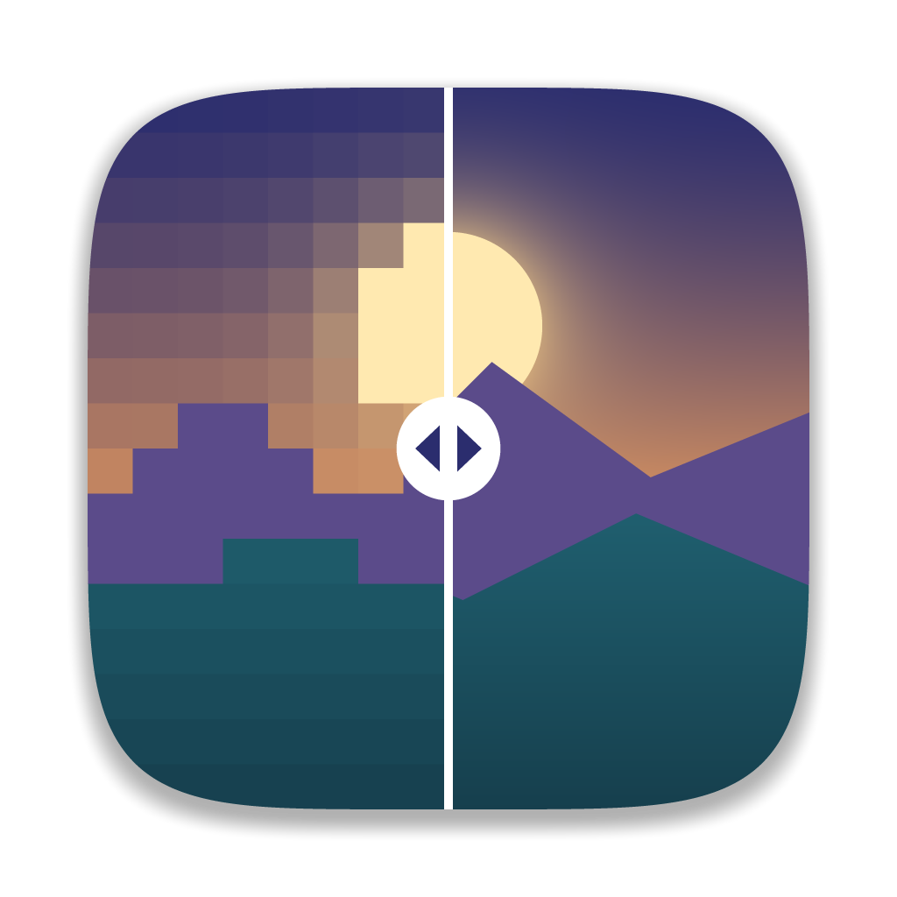
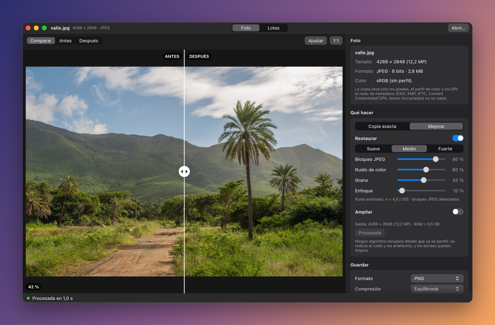
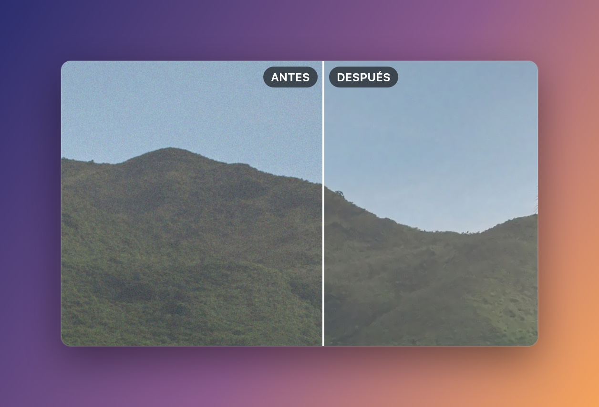
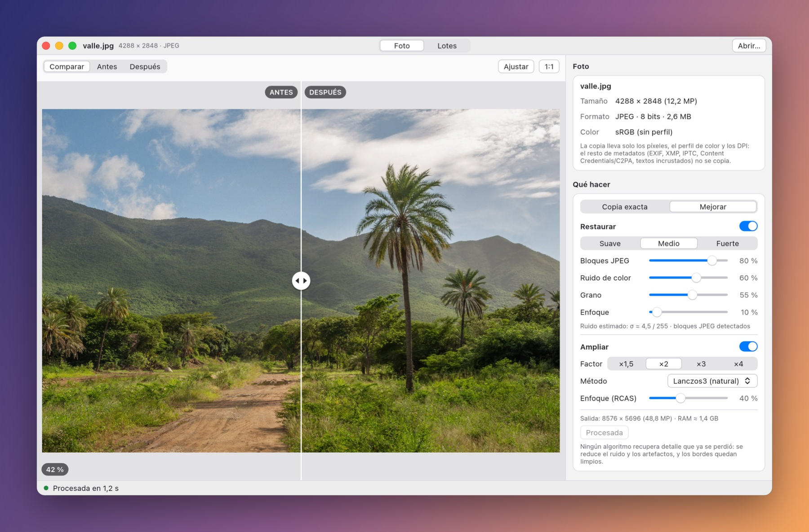
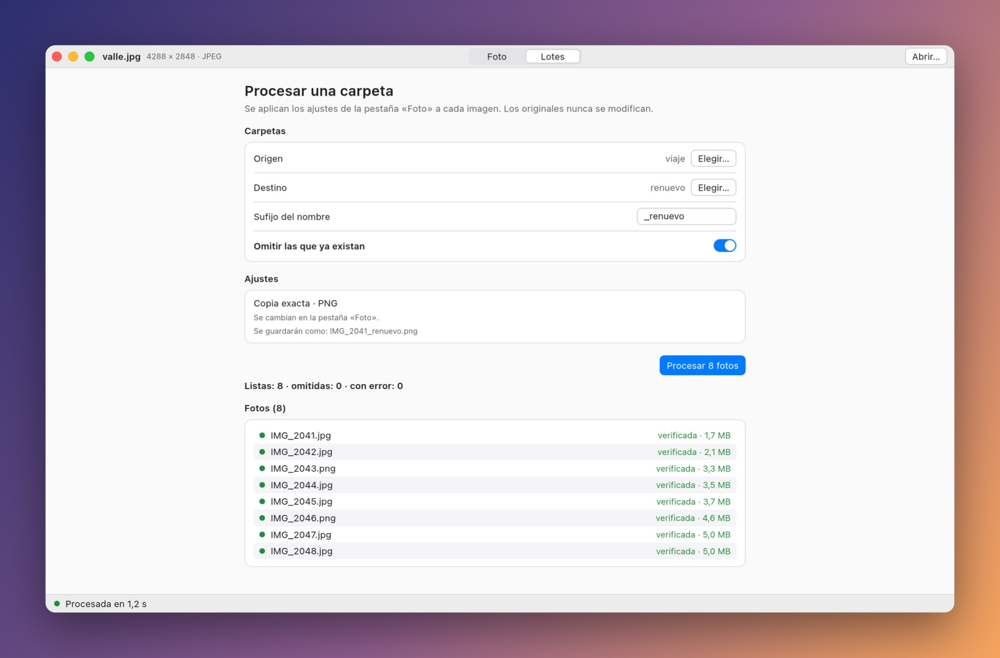

<p align="center">
  
</p>

<h1 align="center">Renuevo</h1>

<p align="center">
  <b>Give your photos a fresh start.</b><br>
  Re-save them pixel-perfect, clean up noise and JPEG artifacts, and upscale them,<br>
  all on your Mac, with classical algorithms and no AI.
</p>

<p align="center">
  
  
  
  
</p>

<p align="center"><b>English</b> · <a href="README.es.md">Español</a></p>



## Why Renuevo?

Photos pick up a lot along the way: sensor noise, blocky JPEG compression, and hidden metadata
such as your GPS location. Renuevo gives you a clean copy you can trust:

- **Nothing is lost by accident.** An exact copy is re-read after saving and compared with the
  original **pixel by pixel**. If a single pixel differs, the file isn't written.
- **Nothing is made up.** Restoration and upscaling use well-understood classical algorithms, not
  generative AI, so you get your photo back, only cleaner, with no invented details.
- **Nothing leaves your Mac.** No accounts, no uploads, no network.

## What it can do

| | |
|---|---|
| 🔒 **Exact copy** | Rewrites every pixel into a lossless PNG, TIFF or WebP and verifies it. 10-bit iPhone HEIC photos stay 16-bit instead of being cut down to 8. |
| ✨ **Restore** | Removes JPEG blocking, color noise and grain (Non-Local Means), then adds a touch of sharpening. It measures the noise in each photo and barely touches clean ones. |
| 🔍 **Upscale** | ×1.5, ×2, ×3 or ×4 with Lanczos3, or with edge-aware EASU plus RCAS sharpening (ported from AMD FidelityFX FSR 1). Saves in 16-bit to avoid banding. |
| 🗂️ **Batch** | Applies the same settings to a whole folder, one photo at a time. It never overwrites an original. |
| 🧹 **Privacy** | Keeps only the pixels, the color profile and the DPI. EXIF (GPS, camera, date), XMP, IPTC, Content Credentials and embedded text are removed. Orientation is applied first, so nothing ends up sideways. |
| 🎨 **Color done right** | Embedded ICC profiles are preserved byte for byte, so Display P3 stays Display P3. HEIC color info, PNG gamma tags and CMYK files are converted the way macOS shows them. |

### See the difference

At 100% zoom, the grain and compression noise of a dim phone shot (left) are gone after
restoring it (right), while the ridge line stays crisp:

<p align="center">
  
</p>

### Feels at home on your Mac

Light and dark mode follow your system. The app uses the San Francisco font, a unified title
bar and a real macOS menu bar with keyboard shortcuts.



### Whole folders at once

Drop a folder on the window, press one button, and every photo is processed and verified. Names
never collide:
`a.jpg` and `a.png` become `a_jpg_renuevo.png` and `a_png_renuevo.png`.



> **Note:** the interface is in Spanish for now.

## Getting started

You need macOS and [Rust](https://rustup.rs) 1.95 or newer. To open HEIC photos, also install
libheif:

```sh
brew install libheif pkg-config     # only needed for HEIC
git clone https://github.com/maxaqquepucho/renuevo.git
cd renuevo
cargo run --release -p renuevo-app  # opens the app
```

You can also pass a photo: `cargo run --release -p renuevo-app -- photo.heic`. Without libheif,
build with `--no-default-features` (everything except HEIC).

### Install it as a regular Mac app

```sh
scripts/bundle-macos.sh                          # builds target/release/Renuevo.app
rm -rf /Applications/Renuevo.app                 # remove the previous copy, if any
cp -R target/release/Renuevo.app /Applications/
```

The app bundles libheif and its libraries, so it keeps working even if you uninstall Homebrew.
A few things to know:

- **macOS version.** The HEIC build needs the macOS version Homebrew built those libraries for.
  `scripts/bundle-macos.sh --sin-heic` makes a smaller app without HEIC that runs on macOS 11 or
  later.
- **Signing.** The app is signed "ad hoc", which is enough for your own Mac. Sharing it would need
  an Apple Developer ID and notarization.

## Keyboard shortcuts

| Action | Shortcut |
|---|---|
| Open a photo | <kbd>⌘</kbd> <kbd>O</kbd> |
| Open a folder for batch processing | <kbd>⇧</kbd> <kbd>⌘</kbd> <kbd>O</kbd> |
| Export | <kbd>⌘</kbd> <kbd>S</kbd> |
| Photo / Batch tab | <kbd>⌘</kbd> <kbd>1</kbd> / <kbd>⌘</kbd> <kbd>2</kbd> |
| Fit to window | <kbd>F</kbd>, <kbd>⌘</kbd> <kbd>9</kbd> or double-click |
| Actual size (1:1) | <kbd>1</kbd> or <kbd>⌘</kbd> <kbd>0</kbd> |
| Zoom | pinch, or <kbd>⌘</kbd> + scroll |
| Pan | drag, or scroll |
| Compare before and after | drag the white line |

## Good to know

- **No algorithm can recover detail that is already gone.** The exact copy guarantees nothing
  *more* is lost. Restoring and upscaling make photos look cleaner and sharper, but they don't
  invent real detail.
- **HDR.** The gain maps of iPhone HDR photos don't fit in PNG, TIFF or WebP. The standard (SDR)
  image is kept and the app tells you so.
- **Multi-image files.** Multi-page TIFFs, animated PNG/WebP and HEIF sequences keep only their
  first (or main) image.
- **Anything inside the pixels stays.** Invisible watermarks, for example, are untouched, because
  the exact copy doesn't change a single pixel.
- **Finder's "Open With" isn't supported yet.** Open photos with <kbd>⌘</kbd> <kbd>O</kbd> or drag them
  onto the window.

The app warns you in its side panel about anything it can't copy. The
[Spanish README](README.es.md) has the full list of edge cases.

<details>
<summary><b>Under the hood</b></summary>

<br>

```
crates/renuevo-core   image library, no GUI: decoding and encoding (incl. HEIC and ICC),
                      verification, restoration (deblocking, chroma, NLM, sharpening),
                      upscaling (Lanczos3, EASU, RCAS), batch, PSNR/SSIM metrics
crates/renuevo-app    the macOS app: eframe/egui 0.37, viewer, settings, batch,
                      macOS theme and native menu bar
```

- **Performance.** On an Apple M5 with a 12 MP photo, verifying an exact copy takes 0.06 s,
  restoring 1.1 s and upscaling ×2 0.3–0.5 s.
- **Optional PNG compression.** The maximum PNG compression uses
  [oxipng](https://github.com/oxipng/oxipng). Files come out about 10% smaller and never bigger,
  but saving is several times slower.
- **Tests.** They check bit-exact round trips (PNG 8/16, TIFF, WebP), byte-exact ICC profiles,
  metadata stripping, real HEIC decoding, CMYK against macOS's own rendering, and that restoring
  and upscaling measurably improve PSNR/SSIM. GUI tests run headless with `egui_kittest`.

```sh
cargo test --workspace                                   # core + GUI
cargo run --release -p renuevo-core --example bench      # speed on a 12 MP photo
```

The screenshots in this README come from the `readme_screenshots` test in
`crates/renuevo-app/tests/render.rs` and `scripts/frame-screenshots.swift`.

</details>

## Credits and license

- **Code.** Renuevo's own code is MIT-licensed. EASU and RCAS are ports of AMD FidelityFX FSR 1
  (MIT). [THIRD_PARTY_NOTICES.md](THIRD_PARTY_NOTICES.md) lists them and the libraries bundled
  in Renuevo.app.
- **Sample photo.** The photo in the screenshots is
  ["San Juan Valley"](https://commons.wikimedia.org/wiki/File:San_Juan_Valley.jpg) by Wilfredor
  (Wikimedia Commons, [CC0](https://creativecommons.org/publicdomain/zero/1.0/)). Noise and JPEG
  compression were added for the demo.
